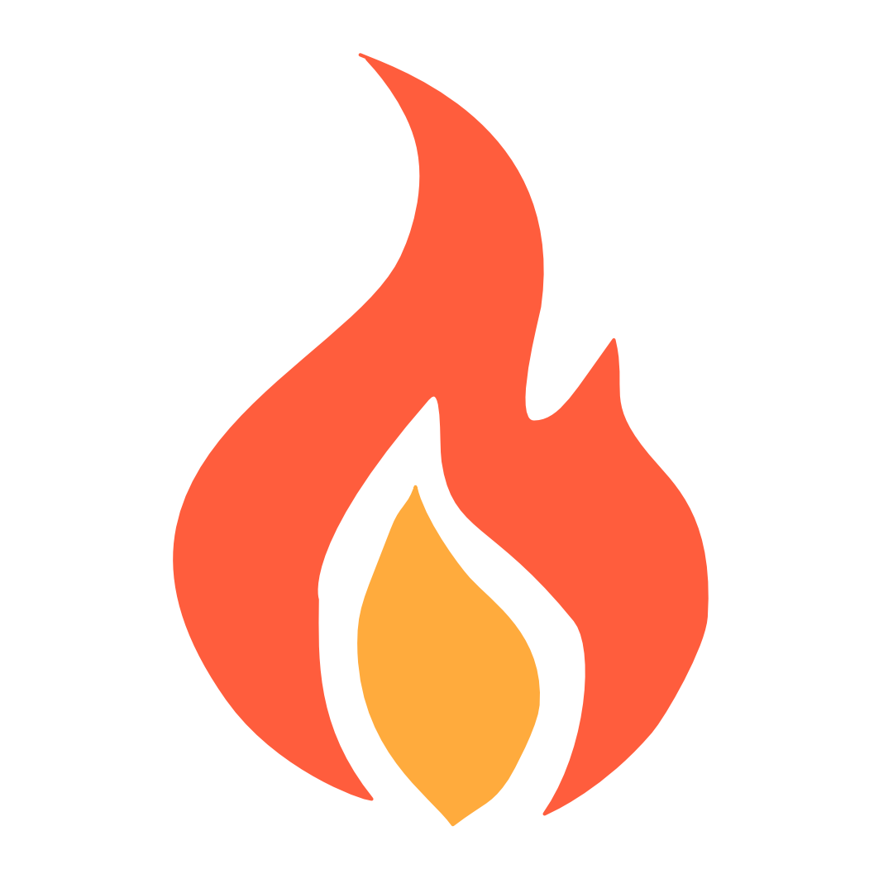
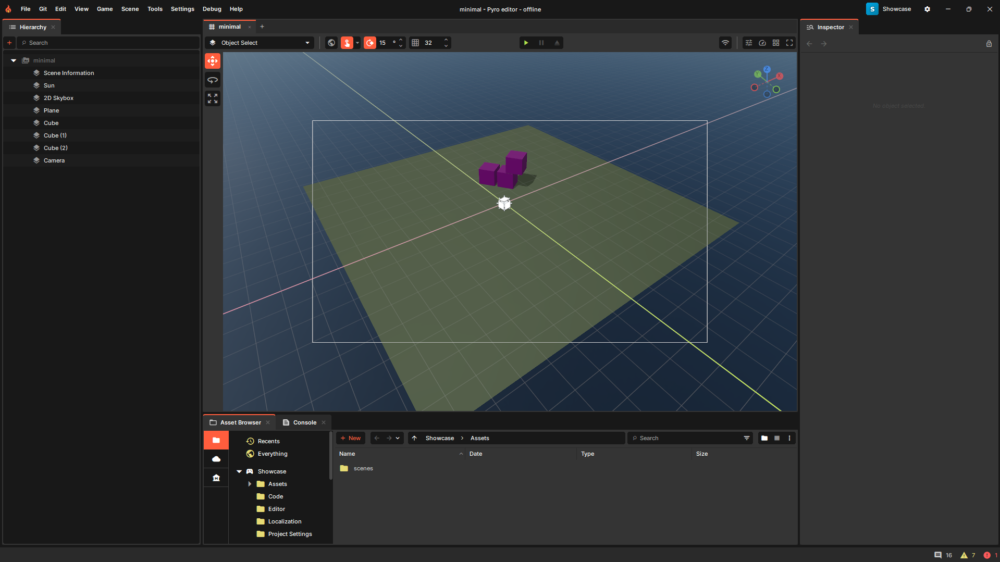

<div align="center">
  

  [Website] | [Getting Started] | [Forums] | [Documentation] | [Contributing]
</div>

[Website]: https://sbox.game/
[Getting Started]: https://sbox.game/learn/getting-started
[Forums]: https://sbox.game/f/
[Documentation]: https://sbox.game/dev/doc/
[Contributing]: CONTRIBUTING.md

# Pyro Engine

Pyro is an fork of [s&box](https://sbox.game), a modern game engine, built on Valve's Source 2 and the latest .NET technology, it provides a modern intuitive editor for creating games, focused on standalone games development.



If your goal is to create games using Pyro, please start with [getting started guide](https://sbox.game/learn/getting-started).

## Getting the engine

### Compiling from source

This repository contains the C# engine, editor, tooling and game content. The native Source 2 core is
distributed as prebuilt binaries that setup downloads for your platform, so no C++ toolchain is needed.

| Platform | Setup | Notes |
|----------|-------|-------|
| Windows 10 / 11 (x64) | `Setup.bat` | |
| Linux (x64) | `./Setup.sh` | Binaries target the Steam Linux Runtime, most distros should work. |
| macOS (Apple Silicon) | `./Setup.sh` | Intel Macs are not supported. |

#### Prerequisites

* [Git](https://git-scm.com/downloads)
* [.NET 10 SDK](https://dotnet.microsoft.com/en-us/download)
* An IDE for the C# code is recommended: [Visual Studio 2026](https://visualstudio.microsoft.com/) or
  [Rider](https://www.jetbrains.com/rider/) on Windows, Rider or [VS Code](https://code.visualstudio.com/) on Linux and macOS.

#### Setup

```bash
# Clone the repo
git clone https://github.com/KaDeroxFR/Pyro-Engine.git
cd Pyro-Engine

# Windows
Setup.bat

# Linux / macOS
./Setup.sh
```

Once setup completes, editor (pyro-dev.exe) run from the `game` folder.

#### Custom features:
- Built-in git tools
- Dev notes
- Visual Changes
- Project Searching
## Contributing

If you would like to contribute to the engine, please see the [contributing guide](CONTRIBUTING.md).

## Documentation

Full documentation, tutorials, and API references are available at [sbox.game/dev/](https://sbox.game/dev/).

## License

The Pyro aswell as s&box engine source code is licensed under the [MIT License](LICENSE.md).

Certain native binaries in `game/bin` are not covered by the MIT license. These binaries are distributed under the s&box EULA. You must agree to the terms of the EULA to use them.

This project includes third-party components that are separately licensed.
Those components are not covered by the MIT license above and remain subject
to their original licenses as indicated in `game/thirdpartylegalnotices`.
